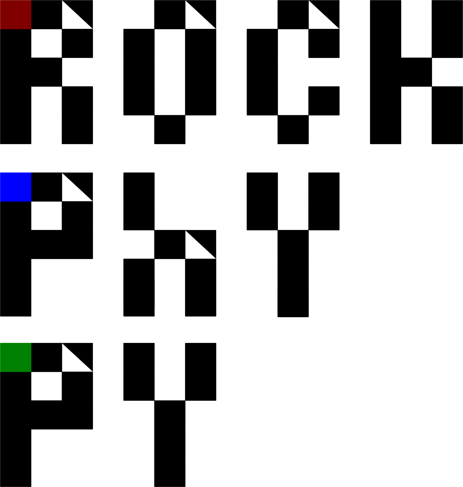

.. rockphypy documentation master file, created by
   sphinx-quickstart on Fri Mar  3 16:42:58 2023.
   You can adapt this file completely to your liking, but it should at least
   contain the root `toctree` directive.

An extensive Python library for rock physics modeling
*****************************************************

``rockphypy`` is a Python-based **open-source library** dedicated to rock physics modeling. It caters to individuals interested in rock physics and empowers them to apply rock physics tools in their work and research effectively.

Built upon the foundations of `Stanford SRB tools <https://github.com/StanfordRockPhysics/SRBToolbox>`_, ``rockphypy`` has successfully migrated and optimized a wide range of rock physics models from Stanford SRB Matlab tools to Python. Additionally, it extends the functionality by introducing new functions and practical workflows. 

Capabilities
------------

``rockphypy`` consists of the following modules:

* :mod:`GM <rockphypy.GM>`: Granular medium models, e.g. Hertz-Mindlin, Walton, Digby, soft-sand, stiff-sand, contact-cement, constant-cement and patchy cement models, and shaly sand mixing
* :mod:`EM <rockphypy.EM>`: Bounds (Voigt-Reuss-Hill, Hashin-Shtrikman) and inclusion models, e.g. Hudson cracks, self-consistent, DEM, Mori-Tanaka and O'Connell-Budiansky
* :mod:`Fluid <rockphypy.Fluid>`: Fluid substitution (Gassmann, Brown-Korringa, Brie mixing) and velocity dispersion and attenuation (Biot, Geertsma-Smit, squirt flow, White and Dutta-Odé patchy saturation)
* :mod:`QI <rockphypy.QI>`: Tools for quantitative interpretation: rock physics templates, rock physics screening, KDE cross plots with elastic bounds and cement volume estimation
* :mod:`AVO <rockphypy.AVO>`: Exact (Zoeppritz) and approximate reflection coefficients for isotropic and anisotropic (HTI, orthorhombic) media, and elastic impedance
* :mod:`Anisotropy <rockphypy.Anisotropy>`: Thomsen parameters, Backus averaging (also from well logs), Bond transformation and phase velocities in VTI and HTI media
* :mod:`BW <rockphypy.BW>`: Original and modified Batzle-Wang equations for the density, bulk modulus and velocity of brine, oil, gas, CO2 and CO2-brine mixtures
* :mod:`Empirical <rockphypy.Emp>`: Empirical velocity-porosity relations (e.g. Han, Krief, Greenberg-Castagna) and porosity- and velocity-depth trends
* :mod:`Permeability <rockphypy.Perm>`: Permeability models, e.g. Kozeny-Carman, Panda-Lake, Revil, Fredrich, Bloch and Bernabé, and empirical relations from well logs
* :mod:`utils <rockphypy.utils>`: Basic calculations: velocities and moduli, Poisson's ratio, Lamé parameters and stiffness matrices for isotropic, VTI and HTI media

For a more detailed understanding of each module, please refer to the :doc:`API Reference <autoapi/index>`.

Installation
------------

``rockphypy`` is available through `PYPI <https://pypi.org/project/rockphypy/>`_ , and may be installed using ``pip``: 

   ``$ pip install rockphypy``

How to cite
-----------

If you use ``rockphypy`` in a publication, please add the following citation:

.. admonition:: Citation

    Yu, J., Mukerji, T., & Avseth, P. (2023). rockphypy: An extensive Python library for rock physics modeling. *SoftwareX*, 24, 101567.
    `doi:10.1016/j.softx.2023.101567 <https://doi.org/10.1016/j.softx.2023.101567>`_

Contribution and Development
----------------------------
See the timeline of ``rockphypy`` `here <https://user-images.githubusercontent.com/45630390/259761842-5689968c-7683-41e4-864a-0dca791a38a0.png>`_  for more details about the development.

``rockphypy`` welcomes contributions from the community. Whether through `pull request <https://github.com/yujiaxin666/RockPhysicsPy/pulls>`_  or by raising questions and making requests via `issue creation <https://github.com/yujiaxin666/RockPhysicsPy/issues>`_. Your active involvement is highly encouraged. Together, we can foster a collaborative and thriving environment for rock physics enthusiasts.

Example code
------------
Below is a simple example demonstrating the usage of the :class:`~rockphypy.EM` and :class:`~rockphypy.Fluid` from the ``rockphypy`` library to create saturated elastic bounds. For further examples, please explore the **Rock physics basics** and **Applications** tabs on the left.

.. plot::
   :include-source:

   from rockphypy import EM
   from rockphypy import Fluid

   # specify model parameters
   phi=np.linspace(0,1,100,endpoint=True) # solid volume fraction = 1-phi
   K0, G0= 37,44 # moduli of grain material
   Kw, Gw= 2.2,0 # moduli of water 
   # VRH bounds
   volumes= np.vstack((1-phi,phi)).T
   M= np.array([K0,Kw])
   K_v,K_r,K_h=EM.VRH(volumes,M)
   # Hashin-Strikmann bound 
   K_UHS,G_UHS= EM.HS(1-phi, K0, Kw,G0,Gw, bound='upper')
   # Critical porosity model
   phic=0.4 # Critical porosity
   phi_=np.linspace(0.001,phic,100,endpoint=True) # solid volume fraction = 1-phi
   K_dry, G_dry= EM.cripor(K0, G0, phi_, phic)# Compute dry-rock moduli
   Ksat, Gsat = Fluid.Gassmann(K_dry,G_dry,K0,Kw,phi_)# saturate rock with water

   # plot
   plt.figure(figsize=(6,6))
   plt.xlabel('Porosity')
   plt.ylabel('Bulk modulus [GPa]')
   plt.title('V, R, VRH, HS bounds')
   plt.plot(phi, K_v,label='K Voigt')
   plt.plot(phi, K_r,label='K Reuss = K HS-')
   plt.plot(phi, K_h,label='K VRH')
   plt.plot(phi, K_UHS,label='K HS+')
   plt.plot(phi_, Ksat,label='K CriPor')
   plt.legend(loc='best')
   plt.grid(ls='--')

.. toctree::
   :hidden:

   getting_started/index
   advanced_examples/index
   autoapi/index
   errata